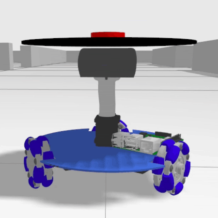
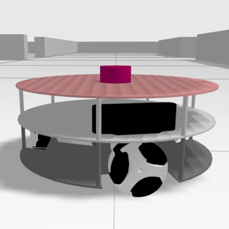
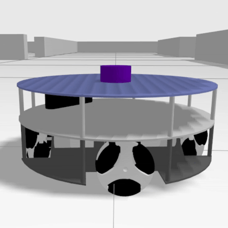
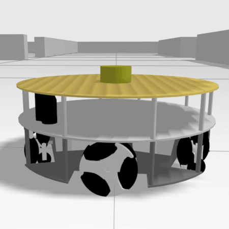
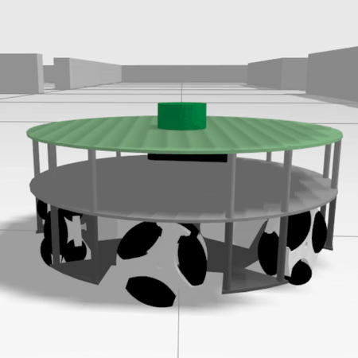
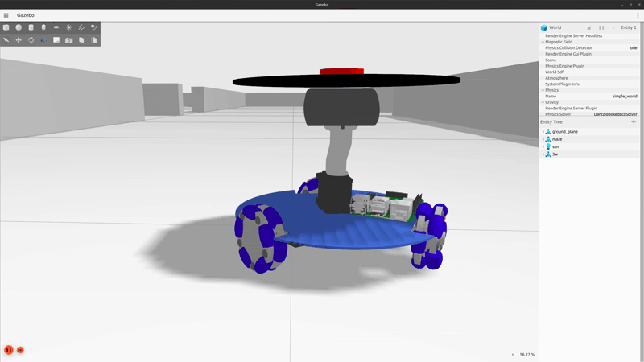
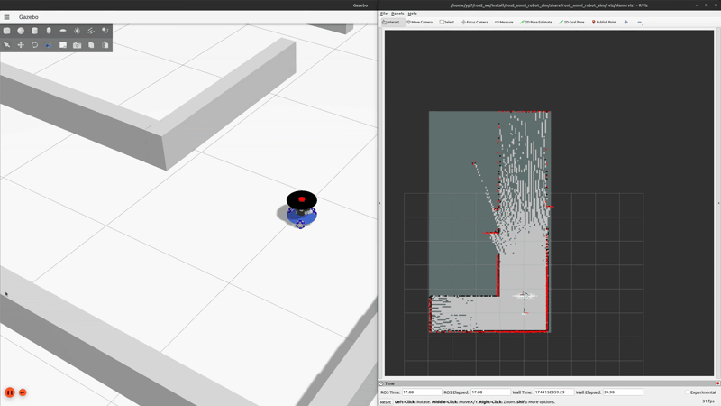
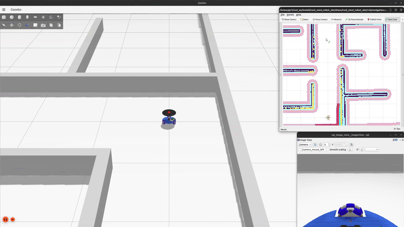

# Omnidirectional Robot Gazebo Simulation

## Introduction

This repository contains a Gazebo Ignition simulation that can be run with ROS 2, enabling the simulation of 3 to 6 wheeled omnidirectional robots. This setup is particularly useful for robotics research and simulation, allowing for the study and testing of complex robot behaviors and control strategies.

### Tested on

- Ubuntu 24.04
- ROS Jazzy
- Gazebo Harmonic

## Available Robot Model

  
*3 wheel omni robot (3w)*

  
*3 wheel omni robot version 2 (3w_v2) -> default*

  
*4 wheel omni robot (4w)*

  
*5 wheel omni robot (5w)*

  
*6 wheel omni robot (6w)*

## How to Use This Repository

Please clone this repository to your ros2 workspace. The following assume your ros2 work space placed on your home directory with named **ros2_ws**

```bash
cd ~/ros2_ws/src
git clone git@github.com:YePeOn7/ros2_omni_robot_sim.git
```

Install dependency by running the following command

```bash
cd ~/ros2_ws/ros2_omni_robot_sim
sudo chmod +x install_dependency.sh
./install_dependency.sh
```

build the package by using the following command

```bash
colcon build
source install/setup.bash
```

Determine the robot Model by setting the environment variable of **OMNI_ROBOT_MODEL** with the robot model listed on [Available Robot Model](#available-robot-model). For example, if you want to use model of **3 wheel omni robot version 2**, you can set as follow:

```bash
export OMNI_ROBOT_MODEL=3w_v2
```

After that you can run several of the following simulations

### 1. Manual Teleop

```bash
ros2 launch ros2_omni_robot_sim gazebo_sim.launch.py
```

or you can specity the world as follow

```bash
ros2 launch ros2_omni_robot_sim gazebo_sim.launch.py world:=<world_name>
```

*please refer to [World Options](#world-options) Section for <world_name>*



### 2. SLAM with slam_toolbox

Start the SLAM by using the following command

```bash
ros2 launch ros2_omni_robot_sim slam_gazebo_sim.launch.py

# with specific world
ros2 launch ros2_omni_robot_sim slam_gazebo_sim.launch.py world:=<world_name>
```

*please refer to [World Options](#world-options) Section for <world_name>*



Save the map by using the following command

```bash
cd ~/ros2_ws/ros2_omni_robot_sim/map # You can use other folder, however you need reconfigure the launch file to use your map
ros2 run nav2_map_server map_saver_cli -f <map_name>
```

**Recommendation**: It is advised to use the **world name** as the **`<map_name>`** when saving your map. This ensures the map is automatically picked up by the launch file without additional configuration.

- For example: If your world is named **`maze1`**, name your map **`maze1`** as well.
- Saved files will be: `maze1.pgm` and `maze1.yaml`.

This consistency simplifies navigation setup and avoids manual path adjustments in your ROS 2 launch files.

### 3. Navigation

Start the SLAM by using the following command

```bash
ros2 launch ros2_omni_robot_sim navigation_gazebo_sim.launch.py

# with specific world
ros2 launch ros2_omni_robot_sim navigation_gazebo_sim.launch.py world:=<world_name>
```

*please refer to [World Options](#world-options) Section for <world_name>*



## Demo Video

[](https://youtu.be/WKV7GRxiQOE)

## World Options

- maze1
- maze2 (default)

## Three-Robot D* Lite + Adaptive Leader/Follower MPC Demo

[Hướng dẫn tiếng Việt: các file MPC, giữ đội hình và cách chạy trong terminal](README_MPC_FORMATION.md).

Build the planner and simulator packages, source the workspace, then launch the
three `3w_v2` robots in `my_maze` with the map server and RViz:

```bash
cd ~/ros2_ws
colcon build --symlink-install --packages-select astar_planner ros2_omni_robot_sim
source install/setup.bash
ros2 launch ros2_omni_robot_sim three_robot_dstar_mpc.launch.py
```

In RViz, select **2D Goal Pose** and click-drag a goal on the map. The node
publishes the leader's D* Lite route on `/dstar_lite/path`, robot paths on
`/robot1/desired_path` through `/robot3/desired_path`, and position/trail
markers on `/three_robot_dstar_mpc/markers`. Each robot runs its own
`robot_distributed_mpc` ROS node, consumes shared poses on
`/formation/robot_states`, exchanges horizon predictions on
`/robotN/mpc_prediction`, and publishes only to its `/robotN/cmd_vel` topic.
LiDAR returns add short-lived obstacles to the grid; changed `/map` cells are
applied incrementally by D* Lite.

To keep the map, planner, and spawn-position markers running without Gazebo or
robot motion, launch with:

```bash
ros2 launch ros2_omni_robot_sim three_robot_dstar_mpc.launch.py simulation:=false motion_enabled:=false
```

### Coordinates and formation reference

The default simulation requires measured world positions from
`/world/my_maze/dynamic_pose/info`, bridged to `/gazebo/world_poses` as
`tf2_msgs/TFMessage`. The coordinator selects the three model names, publishes
their positions in `map` on `/formation/robot_states`, and supplies
`map -> robotN/odom` transforms. Link-relative entries from Gazebo are ignored.
The map raster uses the same origin and axes as the Gazebo world.

Before all three measured poses arrive, the markers show `spawn estimate` and
MPC commands stay zero. Missing/stale poses or references stop the controllers.
Odometry-only operation is an explicit coordinator option
`require_gazebo_pose:=false`; its conversion rotates displacement and yaw by the
spawn orientation before applying the spawn translation. This estimate can
still drift due to wheel slip, so the default simulation uses measured poses.

The default formation is a **triangle with robot3 at the front**, including
the spawn layout: robot3 `(3.5, -2.2)`, robot2 `(3.0, -2.9)`, robot1 `(4.0, -2.9)`;
all face approximately +Y. Gazebo and the coordinator use these same positions.
The standalone `three_robot_gazebo.launch.py` retains its original default
positions; this demo supplies its triangle through spawn launch arguments.
D* Lite plans for the leader. In a column, the order is **robot3 -> robot2 ->
robot1** and followers track
its measured world-position trail with a target gap of **0.70 m along the trail**. The
initial trail connects the measured tail, middle and leader positions using
collision-checked D* routes around the third robot. Subsequent trail points
come from measured leader positions, not predicted future positions.

The default formation now adapts to the space around the **whole team**:

| Situation | Formation and behavior |
| --- | --- |
| Open space | Leader at the front; followers 0.70 m behind, offset 0.50 m to each side of its virtual heading (triangle base 1.00 m). |
| Narrow passage ahead | Check every 0.10 s; hold the leader and fold directly into `robot3 -> robot2 -> robot1`, without intermediate triangle widths. Follow the recorded trail at 0.70 m gaps. |
| Direction reversal with room to pass | Followers yield to opposite sides; leader turns and passes; followers rejoin behind it, preferring a triangle. |
| Whole team returns to open space | Keep the column until the normal triangle and its forward preview fit with extra clearance for at least 0.60 s, then expand. |

`adaptive_leader.py` checks a **1.20 m lookahead**, extending the virtual
leader preview by the 0.70 m follower lag so the full width of a doorway is
checked before the leader enters it. It also checks the follower slots behind
the current leader and their swept movements.
Triangle slots are attached to the leader's smoothed route heading. A sharp
bend alone no longer forces a column, and triangle initialization no longer
depends on having 1.45 m of recorded leader trail. The coordinator attempts a
triangle before starting the leader; a column is used when footprint or
transition clearance does not permit the triangle.
Expansion requires more wall clearance than maintaining the current triangle,
which reduces repeated switching at corridor boundaries. It uses the normal
triangle or a column, choosing a safe left/right assignment with the shortest
estimated transition duration. This is a local selection policy, not a
guarantee of a globally optimal multi-robot route. A new narrow passage can
interrupt an expansion and fold the team from its measured positions.

The leader stays at its measured position during shape changes. The coordinator
first checks simultaneous straight transitions. If they are blocked, it checks
synchronized D* routes for both followers, preserving every route corner. It
also tries sequential routes around stationary teammates and chooses the
safe candidate with the shortest estimated duration.
Every transition checks swept obstacle and inter-robot clearance. If no safe
fold exists, the team holds and rebuilds its routes from measured positions.

### Turning around

Before treating followers as fixed obstacles, the coordinator checks the
obstacle-only route for a team reversal over 105 degrees, a measured leader
heading mismatch over 45 degrees, or a bend over 50 degrees within 0.45 m.
It first tries `RollingTurnMotion`: the leader rotates directly toward the
next route tangent and may depart once its measured yaw error is at most
0.20 rad. Followers can join along their own checked paths during rotation
and translation; follower arrival does not gate the leader's departure.
Each robot has independent measured progress. Shared reference sweeps and the
MPC still hold movements that would lose obstacle or teammate clearance.

The planner prefers a normal triangle after the turn and checks a column if
that does not fit. Concurrent paths include every route corner. If the leader
has to pass before a follower can join, that follower waits for measured
leader progress rather than an assumed elapsed time. After traversing the
checked route prefix (up to 1.40 m for the default gap, bounded by the goal)
and joining, the normal adaptive formation resumes.

If no safe concurrent turn fits, the planner searches for passing bays on
opposite sides of the leader's next route segment. Candidate bays must have
wall clearance and stay at least 0.44 m from that segment. Candidate assignments
are ranked by follower travel; at most eight bay pairs are tried with swept
checks and, when necessary, sequential D* routes around stationary teammates.

This fallback has four separate MPC reference stages:

1. `turnaround / followers yield`: leader holds while followers move aside.
2. `turnaround / leader turns`: followers hold; leader rotates in place.
3. `turnaround / leader passes`: followers hold while leader traverses the
   checked route prefix (up to 1.40 m for the default gap, bounded by the goal).
4. `turnaround / reforming triangle`: followers join safe slots behind the
   new leader direction; a column is used if triangle joining does not fit.

Only the current fallback stage is sent to MPC. Stage changes require measured position
errors below 0.04 m; the rotation stage also requires the leader's yaw error
below 0.12 rad. After rejoining, the route is rebuilt from the new measured
positions. If no pair of safe bays exists, normal routing around teammates
remains active. The planner never forces a lateral move into a wall.

### Tracking and clearance

Reference speed is 0.16 m/s in the full triangle and for the rolling turn's
leader, 0.18 m/s during adaptive
shape changes, and 0.08 m/s in narrow column sections. Launch arguments
`formation_transition_speed` and `formation_open_hold` configure the adaptive
transition speed and the open-space confirmation time. Rolling-turn followers
use the transition speed; tight sections still limit reference speed to
0.08 m/s. The fallback turnaround uses 0.18 m/s and up to 0.85 rad/s references.
Clearance recovery retains its own slower speed limits. In a column, each
follower's progress is limited by its predecessor's measured progress; a
Euclidean-distance guard also holds rear robots at hairpins. The leader slows
or waits when followers fall behind. The RViz goal is the **leader's**
destination; followers finish in safe slots behind it. The launch argument
`leader_robot` changes the leader; the other two are ordered by distance from
its spawn position. Use `adaptive_formation:=false` for column-only operation.

The inflated D* search grid uses a 0.18 m planning radius, measured from each
cell center to occupied cell boxes. This includes diagonal corner cells that
a center-to-center inflation disk could miss. Continuous pose and segment
checks use the same cell boxes. A pose can join the search grid through
a short connector only when that entire connector has planning clearance.
MPC uses a 0.15 m circular collision radius and a soft cost that prefers 0.22 m
clearance. These values are specific to the current `3w_v2` geometry; the body
extends about 0.125 m from its center. Normal MPC peer predictions use 0.34 m
separation; the next command also checks a 0.38 m buffer against measured peer
positions, and the cost prefers 0.46 m. This provides room for feedback error
and braking before the robots become too close.

Routing prefers 0.38 m between robot centers. A measured close pair can leave
this preferred buffer through a checked
connector that never gets closer to that teammate. Its first connector is
preserved during path simplification. Recovery is permitted only above the
physical footprint limit `2 * robot_radius + 0.02` (0.32 m by default), and
every recovery sweep must maintain or increase its initial peer separation.
Normal approaches continue to use the larger buffers. Goal clearance
is still checked normally. Connector warnings identify the start or goal and
report obstacle clearance and measured peer distances separately.

If a measured pose has less than 0.18 m planning clearance but still meets the
0.15 m collision limit, the coordinator first looks for a short recovery path
away from the obstacle. Candidate paths are at most 0.40 m long, checked for
increasing clearance and stationary-peer separation. Recovery references move
one robot at a time at 0.05 m/s, then the convoy route is planned again. A pose
below the collision limit or with no valid recovery path is held and reported;
the code does not move it through a wall or teleport it onto the grid.

If measured peer spacing falls below the routing buffer, the coordinator runs
`peer separation recovery` before planning a new route. It searches movements
of at most 0.30 m, prefers moving a follower while the other robots hold, and
uses 0.05 m/s references toward at least 0.46 m separation. Every candidate is
checked against the map and all teammates. After measured arrival, it rebuilds
the goal route. This handles the logged 0.339 m spacing that previously made
both the planner and MPC reject every command.

Triangle references now limit the motion of **each slot** to 0.22 m/s, slowing
the leader when frame rotation would require faster follower motion. MPC gives
additional weight to lateral tracking error, adds wider steering candidates
near obstacles, and removes duplicate beam states/commands. Known map wall
returns are handled by exact map sweeps rather than repeated LiDAR point
constraints; new obstacles in map-free space remain in the local constraints.

All three controllers consume **one shared reference message** on
`/formation/reference`. Column progress is bounded by predecessor spacing;
triangle progress slows with slot tracking error; transitions share one phase
that waits for measured tracking. Each MPC uses a finite set of velocity
candidates over a receding horizon, with position/yaw tracking, control
smoothness, obstacle clearance and communicated peer predictions. The old
fixed relative XY formation cost is removed so it cannot pull followers across
the inside of a bend. Only that robot's MPC publishes its `cmd_vel`. The
coordinator, MPC nodes and RViz use `/clock` in simulation.

`/formation/reference` is a `PoseArray` in time-major order: robot1/robot2/robot3
at time zero, then the same three at each `mpc_dt` interval. Its length is
`3 * (mpc_horizon + 1)`. Each `/robotN/mpc_prediction` includes the current pose
followed by `mpc_horizon` future poses. Keep `mpc_dt` and `mpc_horizon` identical
on the coordinator and all three MPC nodes. The leader's `desired_path` shows
its planned route. In a column, follower paths show the remaining measured
leader trail (plus initial connectors); targets stop earlier to preserve gaps.
In a triangle they show the current offset reference horizon. During a shape
change they show the planned transition paths. The leader's RViz label and
`Formation:` log messages report the current mode.

After rebuilding, stop the previous launch with Ctrl+C before starting the new
one. On startup, wait for `robotN: using Gazebo world pose in map.` for all three
robots, then use **2D Goal Pose** in RViz. **2D Pose Estimate** does not teleport
Gazebo robots and is not used by this ground-truth simulation.

After selecting a free goal, expect `Leader/follower ready: robot3 -> robot2
-> robot1; gap 0.70 m`. If a robot is near a wall, `Clearance recovery` may
appear before that message. Start with a nearby goal ahead of robot3, then
choose a goal beyond a narrow passage. Look for `forming triangle`, `triangle
/ width 1.00 m`, and `forming column`. Observe the measured robot trails and
spacing around corners in both Gazebo and RViz. Build success alone does
not establish that a complete passage traversal has been validated.

The pre-change planner and README are backed up under
`.codex_backups/20261001_separation_tracking/` at the workspace root. The original
A*/PID demo is separate from this launch.

Focused regression checks run the production MPC with kinematic pose feedback
and no ROS command publishers. They include the measured stuck poses on the
real map, goal replanning after separation, triangle tracking around an open
bend, yaw stage gates, preservation of newly observed LiDAR obstacles, direct
doorway folding, stable reopening and safe simultaneous follower routes:

```bash
source /opt/ros/humble/setup.bash
PYTHONPATH="$PWD/astar_planner:$PYTHONPATH" python3 -m pytest -q \
  astar_planner/test/test_formation_recovery.py \
  astar_planner/test/test_fast_formation_switch.py \
  astar_planner/test/test_rolling_turn.py \
  astar_planner/test/test_mpc_formation_motion.py
```

These checks use a kinematic model; Gazebo wheel/contact dynamics still require
an end-to-end simulation run after restarting the launch.

Useful position diagnostics (Gazebo Fortress uses the `ign` command):

```bash
ros2 topic echo /formation/robot_states --once
ign topic -e -t /world/my_maze/dynamic_pose/info -n 1
```

`map/my_maze.pgm` is rasterized from static collision geometry in
`worlds/my_maze.sdf`; after editing world obstacles, regenerate it with:

```bash
python3 ros2_omni_robot_sim/scripts/generate_my_maze_map.py
```
