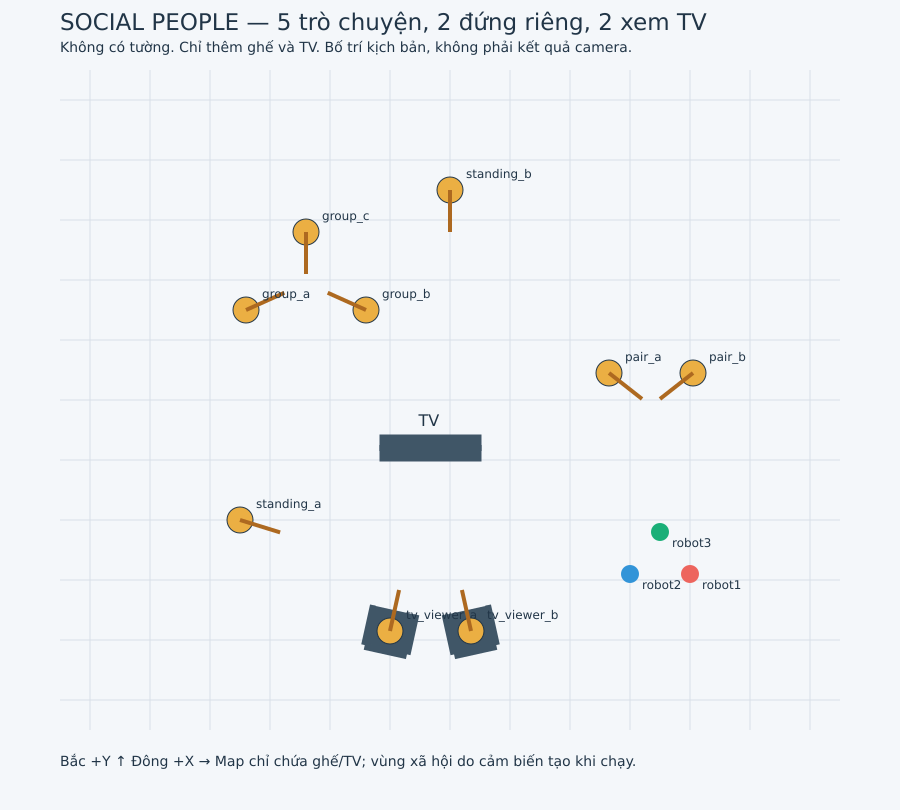

# Test vùng xã hội: nhóm trò chuyện và hai người ngồi xem TV

`three_robot_social.launch.py` mặc định mở **`social_people`**:

- Sàn mở với **9 người**, hai ghế đơn và một TV; không có tường, hành lang hay
  các vật cản thử nghiệm khác. Có lối vòng ở hai bên khu xem TV.
- **Một cặp** gần vị trí xuất phát và **nhóm ba người** có animation tay, đầu,
  thân khi trò chuyện; hai người đứng riêng và **hai người ngồi ghế cùng nhìn TV**.
  Animation có sẵn tại máy,
  lặp khoảng 24 s, không có âm thanh hội thoại.
- Ba robot `3w_v2`, leader mặc định `robot3`; vị trí xuất phát giữ nguyên.
- Map `/map` có kích thước 13 × 11 m, gốc `(-6.5,-5.5)`, độ phân giải 0,05 m.
  Chỉ ghế và đồ đạc TV được đưa vào map vật lý để tránh va chạm.
  **Không vẽ sẵn người vào occupancy**. Vật cản người và vùng xã hội phải được
  bổ sung qua cảm biến. Mép map là giới hạn lập đường, không có tường vật lý.



| Bố trí kịch bản | Tọa độ (m) |
|---|---|
| Cặp gần leader | `(2.65,0.45)`, `(4.05,0.45)`; quay chéo vào vùng giữa họ |
| Nhóm ba người | `(-3.4,1.5)`, `(-1.4,1.5)`, `(-2.4,2.8)` |
| Người đứng riêng | `(-3.5,-2.0)`, `(0,3.5)` |
| Hai người ngồi ghế | `(-1.0,-3.85)`, `(0.35,-3.85)`; cùng hướng về TV |
| TV | `(-0.325,-0.80)`; màn hình hướng về phía hai ghế |
| Leader robot3 | `(3.5,-2.2)`, hướng +Y |

Tọa độ trên chỉ mô tả kịch bản để bạn bố trí thử. Bộ nhận diện và suy luận
**không đọc** vị trí người, tên nhóm, animation hay hướng khai báo trong Gazebo.
Pose của robot vẫn dùng cho định vị/TF.

## Quy tắc phản ứng nhanh với vùng xã hội

| Camera đã đo được | Xử lý |
|---|---|
| Hai người gần nhau, **ít nhất một người hướng về người kia** | Tạo `facing_group` bao cả khoảng giữa, yêu cầu toàn đội đi vòng. Người thứ hai có thể chưa rõ hướng; không cần chờ họ quay lại hoặc thấy TV. |
| **Một người có hướng đo được**, hoặc hai người cùng hướng | Nếu TV đã có trong bộ nhớ và phù hợp hướng nhìn thì khoanh vùng ngay; nếu chưa có, `find_screen` chỉ nhìn nhanh theo hướng đó. |
| **Ít nhất một người** hướng về TV do YOLO định vị | Tạo `viewing_tv` bao khoảng người–TV; không chờ người thứ hai. |
| **Ít nhất một người** hướng về vật nhiều dải màu RGB-D | Tạo `color_attention` bao khoảng người–vật, kể cả YOLO chưa gắn nhãn TV. |
| Chỉ thấy TV/vật nhiều màu | `find_viewers`: tìm người xem và hướng của họ; mục tiêu đứng riêng chưa tạo vùng nhóm. |
| Chỉ có vị trí, chưa đo được hướng nào | Tránh cá nhân/cặp chân, tiếp tục quan sát; không tự gán hướng đứng. |

**Không bắt buộc thấy toàn bộ cơ thể.** Đầu được nhận diện, ước lượng hướng
và định vị bằng RGB-D có thể tạo track người ngay cả khi YOLO không phát hiện
thân bị che khuất. Hướng thân hợp lệ cũng được dùng dù thiếu tay/chân; bộ suy
luận không chặn thêm bằng nhãn `full`/`upper_body`. Bộ ước lượng vẫn kiểm tra
các khớp/hướng đầu có đủ để xác định phía trước, không suy hướng từ hai chân
hoặc một hộp ảnh không có bằng chứng về hướng.

Hai người nhìn vào nhau tạo vùng trò chuyện ngay khi hướng và vị trí đủ ổn
định. Một người nhìn TV cũng đủ tạo vùng xem. Không đợi cửa sổ hoạt động 10 s
hay đợi quét hết vòng: vùng được đưa vào `/social_navigation/map` ở lượt cập
nhật kế tiếp (chu kỳ 0,2 s). Cả D* Lite và ba MPC dùng bản đồ này.

**Khi tới khu xem TV, ưu tiên đi vòng:** chỉ cần hướng của một người phù hợp
với TV/vật nhiều màu đã định vị là đủ. Không quay thêm để xác nhận người thứ
hai, không đợi nhìn lại toàn thân và không phải quay về góc xe trước lượt nhìn.
Lượt nhìn người/tìm TV đang chạy nhận lệnh kết thúc ngay khi vùng liên quan
đã được khoanh; bộ điều phối lấy vị trí hiện tại để lập đường tiếp.

### Ngưỡng mặc định

- Hai người cách nhau **0,50–2,50 m** (`social_group_distance:=2.5`). Ít nhất
  một hướng đầu/thân lệch tối đa **60°** so với đường nối tới người kia là đủ
  bảo vệ khoảng giữa họ. Khoảng cách dưới 0,50 m được giao cho vùng cá nhân
  để giảm nhầm một người thành hai track.
- Nếu **cả hai hướng đã biết** và lệch nhau tối đa **55°**, ưu tiên xem họ là
  cặp cùng hướng cần tìm TV. Điều này tránh nhầm người ngồi hơi lệch trước/
  sau thành đang nhìn nhau. Các cặp có hướng về nhau vẫn tạo vùng nhóm.
- TV/vật màu cách **mỗi người tối đa 4,5 m**, tối thiểu 0,4 m; nằm trong góc
  **60°** phía trước của mỗi người. Chỉnh bằng `social_tv_distance:=4.5`.
- Dùng **≥ 2 lần đo và ≥ 0,2 s**, không chờ đủ lịch sử hoạt động 10 s. Bộ ghép
  vùng chạy mỗi 0,2 s; thời gian phản ứng thực tế còn phụ thuộc camera, depth,
  TF, thời gian suy luận và khả năng quay của MPC.
- Với vùng trò chuyện, cả hai vị trí phải được camera định vị. Với vùng xem
  TV, chỉ cần một người được định vị và có hướng phù hợp. Không gán hướng từ
  quaternion mặc định hoặc vị trí mô tả sẵn trong Gazebo.

Đây là **quy tắc tránh thận trọng**, chưa xác nhận hai người thật sự trò
chuyện. Một người chỉ nhìn ngang qua người kia cũng có thể làm đội robot đi
vòng. Khi đo thấy họ di chuyển hoặc đổi hướng không phù hợp, vùng nhớ được
xóa/cập nhật. Marker `facing_group` giữ tên cũ nhưng nay cho phép chú ý một chiều.

Những nhánh cũ chỉ dựa vào khoảng cách hoặc mục tiêu tự suy ra vẫn bị tắt.
`social_protect_uncertain` và `social_inferred_focus` chỉ còn để đọc launch
cũ; bật `true` không khôi phục các nhánh đó.

### Hai nguồn nhận TV/mục tiêu

- **YOLO TV + RGB-D + TF:** đủ để tạo `viewing_tv` khi có ít nhất một hướng nhìn
  về đó. Không bắt buộc vượt thêm bộ lọc ba màu. Vì topic TV chỉ cung cấp tâm,
  vùng dùng dải màn hình xấp xỉ rộng 1,1 m, marker ghi `approximate screen band`.
- **Vật nhiều dải màu + RGB-D + TF:** giữ quy tắc ≥ 3 nhóm sắc màu đáng kể,
  lấy bề rộng bề mặt thật đã đo để tạo `color_attention`. Tranh/bảng màu cũng
  có thể thỏa quy tắc này. Hai nguồn có timestamp độc lập; nhãn TV không làm
  dữ liệu màu cũ trở thành mới.

Vùng xem thêm đệm tối thiểu 0,40 m, vùng nhóm đệm 0,45 m. Các ô được đặt thành
`100` trong `/social_navigation/map`, dùng cho D* Lite và cả ba MPC. Nếu robot
đã nằm trong vùng vừa phát hiện, chỉ mở lối thoát ngắn trong vùng xã hội;
không xóa ô người hoặc vật cản vật lý.

Nhận diện trong ảnh chưa đủ định vị: nếu log có `RGB only: awaiting aligned
depth and camera_info`, chưa có vị trí map mới để tạo vùng. Xem đồng thời
`/leader/people/status`: `located`, `heads`, `bodies`, `tv`, `color_targets`
và lý do thiếu depth/TF. Thiếu dữ liệu không được coi là không có người/TV.

## Leader tự quay tìm thông tin còn thiếu

Camera gắn cố định trên xe, nên thao tác “quay camera” hiện là **quay thân
leader tại chỗ qua MPC**. Hai follower giữ vị trí đo được. Không có node thứ
hai phát `cmd_vel` cạnh tranh với MPC.

- **Thấy TV trước:** nếu đã nhớ một người hướng về đó thì tạo vùng và đi vòng
  luôn. Khi còn thiếu người/hướng, chỉ nhìn nhanh điểm mục tiêu và hai phía
  lệch 60°, không quét toàn vòng. Có thể ngắm riêng tối đa một người mới.
  Mỗi góc giữ mặc định **0,8 s** sau khi ổn định, kết thúc sớm nếu đã đủ bằng chứng.
- **Thấy một người có hướng, hoặc hai người cùng hướng trước:** nhớ vị trí/hướng, chuyển
  ngay từ lượt nhìn người/tìm người xem sang `find_screen`, không đợi hết
  lượt giữ hoặc cooldown chung 30 s. Chỉ quay về **một điểm theo hướng họ nhìn**,
  giữ ngắn rồi tiếp tục di chuyển; bỏ chuỗi quét trái/phải và quay lại góc ban đầu.
  Khi đã có một mẫu vị trí TV/vật phù hợp, ưu tiên ngắm đúng điểm đã đo. `social_viewing_length` (3,2 m) là khoảng cách điểm
  ngắm tìm ban đầu, không phải một vùng tránh tự dựng.
- **Lượt nhìn người ban đầu (`inspect_person`)** cũng dùng mã lượt/phản hồi
  như tìm TV: vùng trò chuyện hoặc vùng xem đã đủ thì kết thúc ngay. Không
  có lượt nhìn người riêng tiếp tục quay sau khi đã khoanh vùng.
- Mọi lượt **tự quan sát** giới hạn **8 s thời gian thực hoặc 8 s mô phỏng,
  tùy mốc nào tới trước**, tính cả xoay xe và giữ góc. Gazebo chạy chậm không
  còn biến lượt quét thành hơn một phút đứng chờ. Khi không tiến triển góc
  quay/vị trí giữ trong 3 s mô phỏng thì kết thúc sớm. Đổi từ nhìn người sang
  tìm TV giữ thời hạn cũ, không cộng thêm 8 s.
- Nếu hết lượt mà chưa đủ dữ liệu, trạng thái có `evidence unresolved` hoặc
  `aborted: observation timeout`. Robot tiếp tục theo các vùng đã biết; kết
  quả này **không chứng minh không có người xem**. Không tạo giả vị trí/hướng.
- Lượt đã quét xong không lặp lại cùng điểm quan sát trong ít nhất 60 s, trừ
  khi leader đã đổi vị trí ≥ 0,8 m hoặc đo được hướng người đổi ≥ 35°.
  Lượt bị gián đoạn cũng có thời gian chờ mặc định 30 s cho cùng dấu hiệu,
  tránh lặp quay–dừng liên tục. Giữa các lượt thông thường có cooldown 30 s. Hướng người mới
  được ưu tiên bỏ qua cooldown này; lượt bị từ chối vẫn có khoảng chờ thử
  lại (1 s cho tìm TV, 5 s cho tìm người). Khi chuyển từ tìm người sang tìm
  TV, giữ thời hạn của lượt tìm đang chạy để không quay vô hạn.
- Khi camera/pose mất cập nhật hoặc khoảng cách không an toàn, lượt quay
  được hủy. **Goal mới hủy lượt quan sát và lập đường tới goal mới ngay** theo
  các vùng đã biết; nhận diện vẫn cập nhật trong lúc di chuyển. Bản đồ đã
  khoanh vùng không bị xóa khi hủy quét. Tắt tự quay bằng `social_auto_observe:=false`.

### Giảm dừng và lập đường lại gần người

Thay đổi bản đồ xã hội chỉ xóa quỹ đạo nếu chắn chuyển động còn lại của đội.
Nếu đường vẫn đủ khoảng cách, giữ tiến độ và vệt đường leader để follower
tiếp tục bám theo. Kiểm tra bắt đầu từ tiến độ hiện tại, không kiểm tra lại
cả đoạn đã đi qua. Vật cản mới chắn đường vẫn buộc lập lại đường; không giảm
khoảng cách tránh người/vật để ép xe đi. Nếu đặt goal ngay trong vùng cấm,
cần chọn lại goal ở ngoài vùng đó.

**Giới hạn góc nhìn:** quay tại chỗ giúp tìm người ở ngoài khung hình, nhưng
không nhìn xuyên ghế hoặc thấy đầu đang ngoài góc nhìn dọc. Nếu toàn bộ thân
bị che, cần đổi vị trí quan sát; bản này không tự đưa xe vòng quanh ghế để tìm
mặt người. Hướng chưa biết vẫn được giữ là chưa biết.

### Bộ nhớ giữa các góc nhìn

Vị trí/hướng người và TV/vật màu được nhớ **75 s** theo timestamp ảnh để nối các
quan sát từ nhiều góc nhìn. Đọc bộ nhớ không làm dữ liệu mới hơn.
Vùng trò chuyện giữ tối đa 60 s, vùng xem giữ tối đa 90 s, đều tính từ bằng
chứng cũ nhất dùng để tạo vùng. Khi người di chuyển ngoài góc nhìn, vùng nhớ
có thể tạm lỗi thời cho đến lần đo mới hoặc hết hạn.

Bề mặt RGB-D nhìn chéo được xử lý theo mặt phẳng nghiêng; phần màn hình đã
thấy được giữ khi ảnh gần chỉ còn một phần màn hình. Không bắt buộc thấy
người và TV trong cùng ảnh. Người đơn lẻ đã khớp TV không bị tạo thêm vùng
trùng khi camera nhận ra người thứ hai cùng xem.

## Chạy trong terminal

Dừng launch cũ bằng `Ctrl+C`, rồi:

```bash
cd ~/ros2_ws
source /opt/ros/humble/setup.bash
colcon build --symlink-install --packages-select astar_planner ros2_omni_robot_sim
source install/setup.bash
ros2 launch ros2_omni_robot_sim three_robot_social.launch.py
```

Không dùng `social_auto_observe:=false` nếu muốn thử chức năng tự quay tìm
người/màn hình. `motion_enabled:=false` chỉ xem nhận diện, không quay xe.
Map phòng/hành lang trước đây vẫn chọn bằng `social_scene:=rooms`.

Theo dõi ở terminal khác đã source môi trường:

```bash
ros2 topic echo /social_navigation/status
ros2 topic echo /social_navigation/search_status
ros2 topic echo /social_navigation/observation_status
```

Chạy từng lệnh ở một terminal riêng. Các trạng thái cần chú ý:

| Trạng thái | Ý nghĩa |
|---|---|
| `search=inspect_person` | Nhìn nhanh một người mới, tối đa một góc; có vùng thì kết thúc sớm. |
| `search=find_viewers` | Đã thấy mục tiêu, đang tìm người xem. |
| `search=find_screen` | Đã có hướng của một người hoặc hướng chung của hai người, đang tìm màn hình. |
| `holding person view` | Giữ góc vào người mới để lấy hướng/lịch sử. |
| `completed: social evidence acquired` | Đã thu đủ bằng chứng cho quy tắc vùng xã hội. |
| `completed: search exhausted; evidence unresolved` | Đã quét nhưng chưa đủ dữ liệu phân loại. |
| `rejected` / `aborted` | Đọc `reason`: dữ liệu cũ, khoảng cách, cooldown hoặc timeout. `wall-time limit` là đã hết 8 s thực của lượt nhìn nhanh. |

`/social_navigation/search` và `/social_navigation/search_status` dùng JSON
phiên bản 1 trong `std_msgs/String`, có mã lượt `id` để phản hồi của lượt cũ
không kết thúc nhầm lượt mới. Yêu cầu chuyển động phải mới và ở frame `map`.

## Cách quan sát từng trường hợp

1. Đợi đủ ba robot. Trong RViz mở **Leader Person Detection** để xem ảnh thật
   của camera, khung `person`, khớp cơ thể, `colour target (...) | map OK`.
   Marker kịch bản/Gazebo không phải bằng chứng nhận diện.
2. Với **một người hướng về người kia ở gần**, quan sát `facing_group` trong **Camera Social
   Keepout**. `confirmed_regions > 0` có thể xuất hiện khi chưa thấy TV.
   Đặt goal ở phía bên kia nhóm, ngoài vùng tô, để quan sát đường vòng.
3. Với **chỉ TV trong ảnh**, đợi `find_viewers`. Vật có màu chưa đủ tạo vùng:
   khi tìm được ít nhất một người hướng về mục tiêu sẽ có `color_attention`
   hoặc `viewing_tv`.
4. Với **một người có hướng, hoặc hai người cùng hướng nhưng TV ngoài ảnh**, nếu TV
   đã có trong bộ nhớ thì vùng được tạo ngay, không cần thấy `find_screen`.
   Nếu chưa có, camera chỉ nhìn nhanh về phía trước người đó. Khi phát hiện mục tiêu gần, cần
   `color_regions > 0` hoặc `tv_regions > 0` và vùng hồng trên map.
5. Với **hai người quay lưng vào nhau** hoặc hai người cùng hướng nhưng
   không có TV/vật màu, không được kết luận xem TV chỉ vì gần nhau. Vùng
   cá nhân và LiDAR vẫn tránh tiếp xúc với người/vật cản.
6. Thử goal đi ngang khu ghế–TV sau khi vùng hồng xuất hiện. Đường D* Lite và
   cả ba robot phải đi ngoài vùng đó; hình camera chỉ có `Color > 0` chưa đủ.
7. Che phần chân/thân hoặc quan sát người ngồi bị ghế che: nếu đầu vẫn đo
   được (`heads > 0`, `usable_orientations > 0`) và có vị trí RGB-D, vùng xã
   hội vẫn được xét. `people=0` có thể đi kèm `located > 0` khi chỉ nhận được
   đầu. Chỉ thấy chân và không xác định được hướng thì chưa đủ phân loại.

Xóa dữ liệu nhớ giữa các lần đổi bố trí để tránh so sánh với vùng cũ:

```bash
ros2 service call /social_navigation/reset_memory std_srvs/srv/Trigger '{}'
```

Quét thủ công vẫn có thể dùng:

```bash
ros2 service call /social_navigation/observe std_srvs/srv/Trigger '{}'
```

Lượt thủ công giữ khoảng 12 s ở góc đầu, sau đó quét ngắn ở các góc tiếp.
Goal mới hủy lượt thủ công này. Các bước trên là hướng dẫn chạy thử;
**chưa xác nhận chức năng mới bằng một phiên Gazebo thực tế**.

## Nhận diện người và lịch sử 10 giây

```text
RGB -> YOLO person -> crop từng người -> OpenPose MobileNet: khớp 2D
                            + RGB-D, CameraInfo, TF theo timestamp
                            -> vị trí người và hướng đầu/thân trong map
                            -> một người hướng về người kia ở gần: vùng tránh nhóm
                            -> hướng một/hai người: tìm TV/vật màu gần -> vùng xem
RGB -> mặt YuNet (không cần hộp person) + RGB-D + TF -> vị trí/hướng đầu
RGB -> vùng nhiều dải màu + RGB-D -> tọa độ/bề rộng mục tiêu
LiDAR -> ứng viên cặp chân -> tránh từng ứng viên, không tự gán hướng
```

YOLOv4-tiny nhận `person`; OpenPose MobileNet xử lý riêng mỗi crop để giảm
trộn khớp giữa người. Trục vai/hông và bằng chứng mặt hỗ trợ xác định trước/
sau. Khớp bị che hoặc depth/TF không hợp lệ được bỏ qua. Chỉ thấy chân chưa
đủ hướng đứng. Mô hình hiện tại **không phải Part-HOE**.

`human_activity_analysis.py` vẫn thu lịch sử khoảng 10 s: ≥ 12 mẫu và ≥ 75%
độ phủ thời gian, mất người liên tục 2 s thì bỏ track. Chuyển động tay/thân
và hướng tương tác tạo giả thuyết `conversation_candidate`, không xác nhận
có lời nói. Quy tắc vùng xã hội dùng hướng ổn định ngắn nên không bắt buộc
chờ đủ 10 s; nhãn hoạt động và độ phủ được xem riêng ở **Camera Body Activity
(10s)**. Dự báo vị trí chỉ giới hạn 1,5 s, không dự báo chắc chắn 10 s tới.

```bash
ros2 topic echo /leader/people/body_observations
ros2 topic echo /leader/people/activity
ros2 topic echo /leader/people/color_targets
```

## Tham số và file chính

| Tham số launch | Mặc định | Ý nghĩa |
|---|---|---|
| `social_scene` | `people` | Sàn mở, 9 người, ghế/TV; `rooms` chọn map cũ. |
| `social_auto_observe` | `true` | Tự nhìn người mới và tìm người xem/màn hình còn thiếu. |
| `social_observation` | `true` | Cho phép coordinator thực hiện lượt quay qua MPC. |
| `social_observe_cooldown` | `30.0` | Cooldown lượt thường; hướng người mới cần tìm TV được ưu tiên. |
| `social_viewing_length` | `3.2` | Khoảng cách điểm ngắm ban đầu theo hướng người (m). |
| `social_group_distance` | `2.5` | Khoảng cách tối đa giữa hai người (m). |
| `social_tv_distance` | `4.5` | Khoảng cách tối đa từ mỗi người tới TV/vật màu (m). |
| `social_group_margin` | `0.45` | Đệm vùng trò chuyện, chưa gồm bán kính robot (m). |
| `social_color_attention` | `true` | Bật mục tiêu TV/vật màu, vùng xem và tìm thông tin thiếu. |
| `social_color_person_memory` | `75.0` | Nhớ vị trí/hướng người giữa các góc nhìn (s). |
| `social_color_object_memory` | `75.0` | Nhớ TV/vật màu (s), giữ timestamp từng nguồn. |
| `social_color_zone_memory` | `90.0` | Tuổi tối đa vùng xem tính từ bằng chứng cũ nhất (s). |
| `social_zone_memory` | `60.0` | Tuổi tối đa vùng trò chuyện (s). |
| `social_analysis_window` | `10.0` | Cửa sổ phân tích hoạt động, 5–30 s. |
| `body_pose_enabled` | `true` | Khớp cơ thể và phân tích lịch sử. |
| `body_input_size` / `body_max_people` | `256` / `3` | Kích thước crop và số người xử lý tối đa mỗi ảnh. |
| `leg_detection` | `true` | Cụm LiDAR có thể là chân, chỉ tạo vùng cá nhân. |

`social_group_distance` nay quyết định ngưỡng gần trong quy tắc mới. Tham số
cũ `social_provisional_memory` không còn quyết định vùng nhóm.

| File | Vai trò |
|---|---|
| `scripts/social_navigation.py` | Ghép dữ liệu và vùng vào map của toàn đội; trạng thái và điều phối tìm kiếm. |
| `scripts/social_search.py` | Tìm người xem hoặc màn hình theo bằng chứng thiếu, cooldown và phản hồi theo mã lượt. |
| `scripts/social_space_inference.py` | Chú ý một chiều tới người gần, cặp cùng hướng và hình học vùng. |
| `scripts/color_attention.py` | Bộ nhớ vị trí kể cả hướng chưa biết, ghép chú ý một chiều/TV/màu và loại vùng mâu thuẫn. |
| `scripts/colorful_targets.py` | Phát hiện vật nhiều màu trên RGB và định vị bề mặt bằng depth/TF. |
| `scripts/leader_person_detector.py` | YOLO, hướng đầu, pose theo crop và kết quả ảnh. |
| `scripts/head_pose_estimation.py` | Ước lượng hướng đầu từ mặt; chấp nhận mặt thấy riêng khi thân bị che. |
| `scripts/body_pose_estimation.py` | Khớp RGB-D và hướng thân có điều kiện. |
| `scripts/human_activity_analysis.py` | Track và phân tích lịch sử 10 s. |
| `scripts/leader_leg_candidates.py` | Ứng viên cặp chân, bỏ cụm gần robot. |
| `../astar_planner/astar_planner/social_observation.py` | Quét có phản hồi góc thực tế, giữ quan sát và giới hạn thời gian. |
| `../astar_planner/astar_planner/three_robot_dstar_mpc.py` | Nhận yêu cầu quay, kiểm tra khoảng cách/dữ liệu và phát tham chiếu MPC. |
| `scripts/generate_social_people_world.py` | Sinh world, map vật lý và manifest mô tả. |
| `scripts/generate_talking_people.py` | Sinh animation cử chỉ. |

Sinh lại asset khi sửa generator:

```bash
python3 ros2_omni_robot_sim/scripts/generate_talking_people.py
python3 ros2_omni_robot_sim/scripts/generate_social_people_world.py
colcon build --symlink-install --packages-select astar_planner ros2_omni_robot_sim
```

Bản nguồn trước lần sửa này lưu tại
`~/ros2_ws/.codex_backups/20261012_social_quick_glance/`.
Bản trước đó nằm tại `20261012_social_single_viewer`, `20261012_social_fast_rules` và `20261012_social_search`
trong `.codex_backups`.
Các bản cũ hơn vẫn ở `20261011_color_attention`, `20261011_social_group_tv`
và `20261011_people_motion` trong `.codex_backups`.
