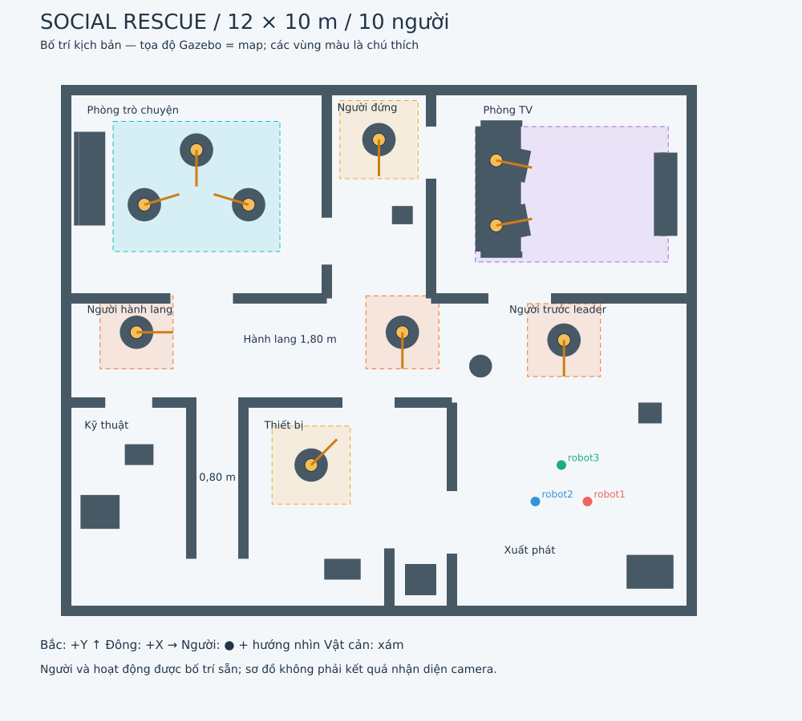

# Map social_rescue: phòng, hành lang và TV

**Launch mặc định hiện mở map sàn mở, nhóm người và hai người ngồi xem TV.**
Xem [README_SOCIAL_PEOPLE.md](README_SOCIAL_PEOPLE.md) cho yêu cầu mới. Tài liệu
dưới đây dành cho `social_scene:=rooms`. Khi bật pose cơ thể (mặc định), góc
quan sát đầu giữ 12 s và xác nhận hoạt động cần lịch sử 10 s. Vùng tạm giữa
người được tạo sớm trong lúc chờ. Đặt `body_pose_enabled:=false`
để dùng riêng pipeline hướng đầu/thời gian quét ngắn mô tả bên dưới.

World đã thu gọn còn **12 × 10 m** (120 m², khoảng 28% diện tích bản 24 × 18 m).
Có **4 phòng**, hành lang nối nhau, góc khuất và **10 người**, trong đó có
**3 người mới ngay trên hành lang** để thử camera mà không cần đi xa. Dùng ba robot `3w_v2`, camera RGB-D và LiDAR nhiều tầng
của leader cùng bộ điều khiển D* Lite / MPC / đội hình hiện tại.
Launch này bật **YOLOv4-tiny, ước lượng hướng đầu từ ảnh, quan sát chủ động
và vùng tránh xã hội dùng chung cho D* Lite / ba MPC**. Hướng đầu là ước lượng,
không đo hướng mắt hoặc khẳng định người đang nói chuyện.
Tên world Gazebo là `social_rescue`; frame ROS vẫn là `map`, trùng tọa độ world.
Map occupancy có độ phân giải 0,05 m, 260 × 220 ô, gốc `[-6.5, -5.5, 0]`.



## Chạy

Dừng phiên launch cũ bằng `Ctrl+C`, sau đó:

```bash
cd ~/ros2_ws
source /opt/ros/humble/setup.bash
colcon build --symlink-install --packages-select astar_planner ros2_omni_robot_sim
source install/setup.bash
ros2 launch ros2_omni_robot_sim three_robot_social.launch.py social_scene:=rooms
```

Đặt đích leader bằng **2D Goal Pose** trong RViz. Robot vẫn xuất phát thành
tam giác tại `robot1=(4.0,-2.9)`, `robot2=(3.0,-2.9)`, `robot3=(3.5,-2.2)`;
hướng ban đầu khoảng +Y và mặc định leader là `robot3`.

Các tham số của launch D* / MPC vẫn dùng được, ví dụ:

```bash
# Quan sát cảnh và ảnh camera khi robot đứng yên.
ros2 launch ros2_omni_robot_sim three_robot_social.launch.py social_scene:=rooms motion_enabled:=false

# Giảm tần số render ảnh nếu máy chậm.
ros2 launch ros2_omni_robot_sim three_robot_social.launch.py social_scene:=rooms camera_rate:=10

# Tắt node chú thích kịch bản trên RViz.
ros2 launch ros2_omni_robot_sim three_robot_social.launch.py social_scene:=rooms scenario_annotations:=false

# Giảm tải xử lý ảnh trên CPU.
ros2 launch ros2_omni_robot_sim three_robot_social.launch.py social_scene:=rooms person_detection_rate:=2.0 person_input_size:=320

# Chỉ xem cảnh, tắt nhận diện (bật Leader RGB Camera (raw) trong RViz).
ros2 launch ros2_omni_robot_sim three_robot_social.launch.py social_scene:=rooms person_detection:=false
```

Model đã được lưu trong package; chạy không cần tải mạng, PyTorch hay CUDA.
Nếu clone sang máy mới còn thiếu thư viện, cài dependency ROS/Ubuntu:

```bash
sudo apt install python3-opencv ros-humble-cv-bridge ros-humble-vision-msgs
```

Không cần cài `opencv-python`/nâng NumPy bằng pip cho bộ nhận diện này.

## Leader quay quan sát

Mặc định, khi camera định vị ổn định một người mới ở khoảng 0,8–4,5 m, leader
tạm dừng, hướng về người đó, nhìn lệch trái/phải 55° rồi trở lại hướng ban đầu.
Hai follower giữ vị trí đo lúc bắt đầu. Điều phối phát tham chiếu qua
`/formation/reference`; cả ba MPC vẫn kiểm tra vật cản và khoảng cách giữa xe.
Không có node thứ hai ghi đè lệnh `/cmd_vel`.

- Tốc độ tham chiếu quay mặc định **0,75 rad/s**; tại mỗi hướng, chờ sai số
  góc ≤ 0,12 rad và sai số vị trí ≤ 0,07 m, rồi giữ ảnh **0,8 s**.
- Quét tự động cách nhau ít nhất **30 s thời gian mô phỏng**. Vùng người đã
  yêu cầu quan sát được nhớ 60 s để hạn chế quay lặp tại cùng chỗ.
- Không bắt đầu khi đang nhường đường/khôi phục khoảng cách, pose hoặc ảnh
  xử lý bị cũ, hoặc chỗ đứng không đủ khoảng cách. Hết thời hạn, mất ảnh,
  thay đổi khoảng cách an toàn hoặc lệch vị trí quá 0,18 m sẽ hủy lượt quét.
- Sau lượt quét, D* Lite lập lại đường từ vị trí thực với vùng tránh mới.
  Đặt goal mới sẽ hủy lượt quét hiện tại. `motion_enabled:=false` tắt quay.

Muốn **quét đủ 360°**, gọi ở terminal khác sau khi đã source workspace:

```bash
ros2 service call /social_navigation/observe std_srvs/srv/Trigger '{}'
```

Leader lần lượt nhìn các hướng cách nhau 60°, rồi trở về hướng ban đầu.
Service trả lời `success: true` nghĩa là **đã nhận và bắt đầu**, chưa phải đã
quét xong. Xem tiến trình/kết quả:

```bash
ros2 topic echo /social_navigation/observation_status
ros2 topic echo /social_navigation/status
```

Thời hạn quét tính theo tổng góc, tốc độ và thời gian giữ ảnh, tối đa 40 s mô
phỏng; thời gian thực còn phụ thuộc tốc độ Gazebo và khả năng bám của MPC.
Quay tại chỗ mở rộng góc nhìn, nhưng không nhìn xuyên vật che hoặc nhìn được
mặt trước của người đang quay lưng. Trường hợp này cần đưa leader tới một vị
trí quan sát khác bằng goal ở vùng trống.

```bash
# Chỉ quay khi gọi service, không tự ngắt hành trình để quét.
ros2 launch ros2_omni_robot_sim three_robot_social.launch.py social_scene:=rooms social_auto_observe:=false

# Tắt toàn bộ chế độ quay; vẫn suy luận vùng tránh từ ảnh đang nhìn thấy.
ros2 launch ros2_omni_robot_sim three_robot_social.launch.py social_scene:=rooms social_observation:=false
```

## Những gì có trong cảnh

Bố trí được vẽ lại để rút ngắn quãng đường; robot/người vẫn giữ kích thước
thực, cửa hẹp vẫn đủ cho từng robot đi qua. Người trong hành lang được đặt
lệch sang một phía, chừa lối vòng; nhánh rộng 0,80 m không đặt người giữa lối.

| Khu vực | Tọa độ x, y (m) | Nội dung |
|---|---|---|
| Phòng trò chuyện | Tâm `(-3.5, 3.0)` | Ba người, ghế dài; cửa trước 1,20 m và cửa bên 0,90 m. |
| Phòng TV | Tâm `(3.5, 3.0)` | Hai người **ngồi** tại `(2.25,2.40)` và `(2.25,3.65)`, cùng hướng về TV `(5.45,3.0)`; có đường vòng sau sofa và cửa bên. |
| Phòng kỹ thuật | `x=-5.9…-3.7`, `y=-4.0…-1.1` | Tủ cao 1,60 m, pallet thấp 10 cm; cửa 0,90 m. |
| Phòng thiết bị | `x=-2.5…1.3`, `y=-4.9…-1.1` | Một người đứng, bậc 5 cm, thùng thiết bị và một ngách nhỏ. |
| Người trước leader | **`(3.55, 0.20)`** | Cách leader lúc xuất phát khoảng **2,4 m**, quay mặt về phía camera; nằm trong lối đi từ sảnh. |
| Người ở ngã rẽ | **`(0.45, 0.35)`** | Đứng lệch bên hành lang, gần nhánh đi lên phía bắc. |
| Người ở hành lang tây | **`(-4.65, 0.35)`** | Đứng gần phòng trò chuyện/kỹ thuật; hướng nhìn về +X. |
| Người cuối nhánh bắc | `(0.0, 4.05)` | Đứng quay về -Y; có thể nhìn từ đầu nhánh. |
| Người trong phòng thiết bị | `(-1.3, -2.2)` | Đứng riêng, hướng 45°. |
| Hành lang ngang | `y=0` | Rộng 1,80 m ở phía tây, nối với sảnh rộng và nhánh bắc. |
| Nhánh bắc | `x=0`, `y=1.1…4.9` | Rộng 1,80 m, thông sang hai phòng qua cửa bên. |
| Nhánh hẹp phía nam | `x=-3.1`, `y=-4.0…-1.0` | Rộng 0,80 m, dài 3,0 m; mở ra lối vòng phía sau rộng 0,90 m. |
| Bậc thấp | `(-0.7, -4.2)` | Cao 5 cm. |
| Thùng thấp gần sảnh | `(5.2, -1.2)` | Cao 12 cm. |
| Thùng trong nhánh bắc | `(0.45, 2.6)` | Cao 20 cm; chừa lối qua bên trái. |
| Vật cản cao | Nhiều vị trí | Tủ 1,55–1,60 m, cột ở ngã rẽ cao 1,50 m. |

Có **8 người đứng và 2 người ngồi**, đều là mesh có texture và đứng/ngồi tĩnh.
Người đứng cao khoảng 1,76 m, collision trụ bán kính 0,32 m. Mesh người ngồi
được uốn tại hông/đầu gối, thân trên hạ xuống sofa; collision hộp 0,88 × 0,62 ×
1,40 m bao cả chân. Ba người ở phòng trò chuyện quay về tâm `(-3.5,3.1)`.
Chưa có animation đi bộ, âm thanh hay video TV. Mesh/texture có sẵn trong package.

## Thử camera với người gần robot

1. Launch map như trên. Leader `robot3` xuất phát tại `(3.5,-2.2)`, hướng +Y.
   Người tại `(3.55,0.20)` nằm ngay phía trước, không bị tường che theo bố trí.
   Có thể dùng `motion_enabled:=false` để xem ảnh lúc xe đứng yên.
2. Mở **Leader Person Detection** trong RViz. Quan sát ảnh và khung `person`
   khi model phát hiện người; **Camera Detected People** hiện điểm định vị nếu
   depth/TF hợp lệ. Đứng trong góc nhìn chưa đảm bảo model luôn nhận diện được.
3. Muốn thử lúc di chuyển, dùng launch mặc định `motion_enabled:=true`, đặt
   **2D Goal Pose** từng điểm dưới đây, chờ đội hình tới rồi mới đặt điểm tiếp.
   Bộ điều phối dùng vị trí goal để tìm đường; mũi tên goal không điều khiển
   hướng camera cuối hành trình. Dùng lượt quét quan sát ở trên để nhìn quanh.

| Điểm đích gợi ý | Mục đích / hướng nhìn |
|---|---|
| `(2.7, 0.0)` | Đi lên hành lang gần người đầu tiên; hướng +Y để nhìn qua cửa phòng TV. |
| `(-1.0, -0.45)` rồi `(-4.0, -0.45)` | Đi dọc hành lang ngang, tiếp cận hai người ở ngã rẽ và phía tây. |
| `(0.0, 1.6)` | Hướng +Y, nhìn về người cuối nhánh bắc. |
| `(-3.4, 1.65)` | Hướng +Y, tới cửa phòng trò chuyện. |
| `(-3.1, -3.4)` rồi `(-3.1, -4.45)` | Qua nhánh 0,80 m và tới lối vòng phía sau để thử đội hình nối đuôi. |

Các điểm trên chọn theo bố trí hình học; chưa chạy thử điều hướng/nhận diện
trên map thu gọn. Không đặt goal trùng tọa độ người hoặc vật cản. Camera cố
định theo thân xe nên lúc xe omni đi ngang/lùi, người có thể ra ngoài góc nhìn.

## Nhận diện người bằng camera leader

Chuỗi dữ liệu đang được nối như sau:

```text
/leader/camera/image_raw -> YOLOv4-tiny -> bbox person + confidence
                                      -> ảnh vẽ khung /leader/people/image
                        -> bbox TV
                        -> YuNet: mặt + 5 mốc -> solvePnP: hướng đầu
          bbox + depth cùng thời điểm + CameraInfo
                  -> điểm 3D trong camera optical frame
                  -> TF tại timestamp ảnh -> vị trí trong map -> marker RViz
```

Mở **Leader Person Detection** trong RViz: ảnh sẽ có khung `person`, điểm tin
cậy và số người thấy được. **Camera Detected People** hiển thị chấm xanh có
nhãn `camera: person` khi depth và TF hợp lệ. Khung vàng `2D only` nghĩa là đã
phát hiện trên ảnh nhưng chưa đủ dữ liệu để đặt điểm lên map. Khi nhìn tường
hoặc chưa thấy người, số phát hiện bằng 0 là bình thường.

| Topic | Kiểu / nội dung |
|---|---|
| `/leader/people/image` | `sensor_msgs/Image`, ảnh có khung nhận diện và thời gian xử lý. |
| `/leader/people/detections_2d` | `vision_msgs/Detection2DArray`, bbox pixel và điểm tin cậy lớp `person`; `id` rỗng vì chưa theo dõi danh tính. |
| `/leader/people/poses` | `geometry_msgs/PoseArray`, các điểm trên bề mặt thân người trong frame `map`; chỉ chứa kết quả có depth/TF hợp lệ. Orientation để identity, **không phải hướng nhìn người**. |
| `/leader/people/head_poses` | `PoseArray` trong `map`: vị trí mặt từ depth; yaw là hướng đầu ước lượng từ mốc ảnh + PnP + TF. |
| `/leader/people/attention_targets` | `PoseArray` trong `map`: vị trí TV được phát hiện trên ảnh và định vị bằng depth. |
| `/leader/people/observation_stamp` | `std_msgs/Header`: timestamp ảnh xử lý xong còn mới, dùng để dừng quét khi mất ảnh. |
| `/leader/people/markers` | `visualization_msgs/MarkerArray`, điểm/nhãn kết quả camera; tự xóa khi hết hạn hoặc mất ảnh. |
| `/leader/people/status` | `std_msgs/String`, số người, số điểm định vị, thời gian xử lý và tình trạng depth/TF. |

Xem ảnh riêng hoặc trạng thái ở terminal mới đã `source install/setup.bash`:

```bash
ros2 run rqt_image_view rqt_image_view /leader/people/image
ros2 topic echo /leader/people/status
```

Tham số launch:

| Tham số | Mặc định | Ý nghĩa |
|---|---|---|
| `person_detection` | `true` | Bật node nhận diện. `leader_camera:=false` cũng tắt node này. |
| `person_confidence` | `0.35` | Ngưỡng điểm; giảm có thể bắt thêm người nhưng cũng tăng nhận nhầm. |
| `person_detection_rate` | `4.0` | Tần số xử lý tối đa theo giây thực; không đảm bảo đạt nếu máy quá tải. |
| `person_input_size` | `416` | Kích thước ảnh vuông đầu vào; bội số 32. `320` nhẹ hơn, `608` tốn CPU hơn. |
| `person_cpu_threads` | `2` | Số luồng OpenCV; tiến trình nhận diện tách khỏi MPC. |
| `head_pose_enabled` | `true` | Bật YuNet + PnP. Tắt thì không suy luận hướng chú ý mới; vẫn giữ vùng tránh quanh người phát hiện được. |
| `social_avoidance` | `true` | Ghép vùng tránh từ camera vào map của D* Lite và cả ba MPC. |
| `social_zone_memory` | `60.0` | Giữ vùng tương tác sau quan sát, theo giây mô phỏng. |
| `social_inferred_focus` | `true` | Cho phép bảo vệ điểm hội tụ hướng đầu dù chưa phát hiện TV; nhãn ghi rõ vật chưa xác nhận. |
| `social_observation` | `true` | Cho phép leader quay quan sát khi camera, nhận diện, tránh xã hội và chuyển động đều bật. |
| `social_auto_observe` | `true` | Tự yêu cầu quan sát người mới; `false` vẫn cho gọi service quay 360°. |
| `social_observe_cooldown` | `30.0` | Khoảng cách tối thiểu giữa hai yêu cầu quét tự động. |
| `observation_angular_speed` | `0.75` | Tốc độ góc tham chiếu khi quan sát, rad/s, phải ≤ 1,0. |
| `observation_dwell` | `0.8` | Giữ ảnh sau khi ổn định tại mỗi hướng, ít nhất 0,4 s. |
| `social_prediction_horizon` | `1.5` | Chân trời dự báo chuyển động người, giây; giới hạn ≤ 2,0 s. |

Node chỉ lấy ảnh mới nhất, chạy một tác vụ suy luận mỗi lần và không tích hàng
đợi ảnh cũ. Depth phải khớp frame/kích thước ảnh, lệch timestamp tối đa 0,06 s;
TF được lấy **tại thời điểm chụp**, tránh dùng pose xe ở thời điểm xử lý xong.
Độ sâu được lọc trong vùng giữa thân người; loại NaN/Inf, khoảng ngoài
0,25–7,50 m và vùng trộn chiều sâu quá lớn. Ảnh quá cũ bị bỏ, mất ảnh sẽ xóa
điểm định vị. Khi thiếu depth/TF, ảnh và kết quả 2D vẫn được xuất.

Các điểm 3D là ước lượng bề mặt nhìn thấy, chưa phải tâm cơ thể chính xác.
Model học trên COCO; cần đánh giá riêng trên người mô phỏng, đặc biệt khi xa,
che khuất hoặc camera thấp chỉ nhìn thấy một phần người. Chưa đo độ chính xác
hoặc tốc độ của pipeline mới trong phiên Gazebo thực tế.

## Suy luận vùng tương tác và dự báo ngắn hạn

`head_pose_estimation.py` ghép 5 mốc mặt YuNet với khuôn mặt 3D mẫu qua
`solvePnP`. Chỉ nhận mặt ≥ 24 pixel, điểm tin cậy ≥ 0,85, độ khớp hình học và
độ sâu hợp lệ. Vector đầu được đổi sang `map` bằng TF tại timestamp ảnh.
Mũi tên xanh nhạt trong **Camera Detected People** thể hiện hướng ước lượng.
Đây chưa phải phép đo mắt, nhận dạng hành động bằng video hoặc nghe hội thoại.

`social_navigation.py` cần tối thiểu 3 quan sát ổn định trong ≥ 0,4 s:

1. **Quay mặt vào nhau:** nối các cặp gần nhau có hướng đầu nhìn vào nhau,
   bảo vệ phần giữa và tâm tương tác ước lượng; thêm biên 0,35 m.
2. **Cùng chú ý một vật:** nếu hai hướng đầu cùng hướng tới một TV phát hiện
   từ ảnh, bảo vệ tam giác người–người–TV, thêm biên 0,25 m. Khi không nhận ra
   TV nhưng hai tia đầu hội tụ hợp lý, nhãn là `object unconfirmed`; có thể
   tắt trường hợp này bằng `social_inferred_focus:=false`.
3. **Người đơn lẻ/chưa thấy mặt:** theo dõi vị trí ẩn danh bằng RGB-D và giữ
   vùng tránh 0,40 m. Không có hướng đầu thì không tự gán nhãn trò chuyện/xem TV.
4. **Chuyển động:** khớp vận tốc từ ≥ 4 quan sát kéo dài ≥ 0,8 s; chỉ dự báo
   khi dịch chuyển ≥ 0,25 m, tốc độ 0,20–1,50 m/s và sai số khớp ≤ 0,12 m.
   Bảo vệ một hành lang theo vận tốc không đổi, mặc định tới 1,5 s, có biên
   bất định. Mất dấu thì giới hạn ngoại suy và xóa track sau 3 s.

Cửa sổ nhớ hướng đầu 8 s giúp ghép các hướng nhìn trong lượt quét. Vùng nhóm
đã suy luận được giữ 60 s mặc định khi người ra khỏi ảnh. Điều này giả định
nhóm còn ở gần chỗ đã quan sát; nhóm thay đổi sau góc khuất có thể để lại vùng
tránh cũ tới khi hết hạn. Nhiễu nhỏ được giữ nguyên, vùng người cập nhật tối đa
1 Hz để hạn chế lập lại đường liên tục. Đây là dự báo hình học ngắn hạn, chưa
phải dự đoán ý định hoặc một mô hình hành vi đã được đánh giá.

| Topic | Vai trò |
|---|---|
| `/map` | Map vật lý gốc. |
| `/social_navigation/map` | Map gốc + vùng tránh, đưa vào D* Lite và **cả ba MPC**. |
| `/social_navigation/keepout` | Chỉ lớp xã hội: 100 là ô cấm, -1 là không thêm thông tin. |
| `/social_navigation/markers` | Biên vùng đã gồm margin, nhãn nguồn suy luận; RViz: **Camera Social Keepout**. |
| `/social_navigation/status` | Số hướng đầu dùng được, track người/TV và vùng nhóm đang nhớ. |
| `/social_navigation/look_at` | Yêu cầu nhìn về điểm người đo được, do node xã hội phát cho điều phối. |
| `/social_navigation/observation_status` | `scanning`, `completed`, `aborted`, `cancelled` hoặc `rejected` kèm lý do. |

Khi có đường vòng hợp lệ, planner tìm đường ngoài các vùng cấm. Nếu vùng cấm
che kín lối hoặc goal nằm trong vùng, xe có thể dừng vì không còn đường;
không đảm bảo mọi goal đều tới được. Nếu vừa phát hiện vùng phủ lên vị trí xe,
lớp xã hội để một lối thoát ngắn tới mép vùng, không xóa ô va chạm vật lý.
Lớp này vẫn được MPC kiểm tra cùng LiDAR và khoảng cách giữa các robot.

Xóa bộ nhớ quan sát/vùng cũ khi đã thay đổi cảnh:

```bash
ros2 service call /social_navigation/reset_memory std_srvs/srv/Trigger '{}'
```

**Gợi ý thử bằng RViz:** tới vùng trống phía đông/đông nam sofa, ví dụ
`(4.4,1.5)` hoặc `(3.8,1.55)`, gọi quét 360° và xem số `heads`, `tv`, cùng
marker vùng tránh. Với nhóm trò chuyện, thử quan sát từ `(−1.8,1.8)`.
Các điểm là gợi ý hình học, chưa chạy xác nhận trong Gazebo. Đợi vùng suy luận
hiện rồi đặt goal ở phía bên kia, ngoài vùng; chẳng hạn `(4.3,4.5)` trong
phòng TV. Quan sát cả đường D* và chuyển động ba xe, không dùng marker ground
truth làm bằng chứng camera nhận diện thành công.

Trong cảnh hiện tại, người là mô hình tĩnh. Muốn đánh giá dự báo người đi bộ
cần thêm chuyển động người và cập nhật vật cản tương ứng; phần đó chưa được
đo trong phiên này. Quét, hướng đầu, vùng nhóm và hiệu quả đi vòng mới cũng
**chưa chạy kiểm thử Gazebo**; build thành công không chứng minh độ chính xác.

## Chú thích kịch bản

- `Leader RGB Camera (raw)` trong RViz hiển thị `/leader/camera/image_raw`; depth và
  nội tham số vẫn là `/leader/camera/depth/image_raw`, `/leader/camera/camera_info`.
- `Scenario People (ground truth)` hiển thị vị trí và hướng người **đã khai báo
  trong kịch bản**, phát trên `/social_scene/people`. Mặc định tắt để dễ quan sát
  những người camera thực sự phát hiện.
- Bật `Scenario Zones (ground truth)` trong RViz nếu muốn xem các vùng chú
  thích, phát trên `/social_scene/ground_truth_zones`. Mặc định lớp này tắt.
- `config/social_rescue_scene.json` chứa tên người, vị trí, hướng nhìn, nhóm,
  hoạt động, kích thước các vùng minh họa và vị trí vật cản.

**Các topic `/social_scene/...` là ground truth của kịch bản; kết quả camera
ở `/leader/people/...`.** Node nhận diện không đọc manifest hoặc pose người
trong Gazebo. Node xã hội cũng không đọc vị trí/hướng/nhóm người khai báo;
nó dùng kết quả camera để tạo `/social_navigation/...`. Pose Gazebo của **robot**
vẫn dùng cho định vị và TF. Kích thước vùng minh họa và margin điều hướng là
tham số của bản mô phỏng, chưa được hiệu chỉnh bằng đánh giá thực nghiệm.

Map tĩnh hiện chứa cả vật thấp và footprint của những người đứng cố định. Vì
vậy robot tránh được chúng bằng map chưa chứng minh khả năng phát hiện của
camera/LiDAR. Khi đổi vị trí người trong Gazebo, cần cập nhật ground truth và
tái tạo map, hoặc chuyển sang một kịch bản người động với lớp vật cản động.

## File cần sửa khi thay đổi cảnh

| File | Vai trò |
|---|---|
| `scripts/generate_social_rescue_world.py` | Nguồn bố trí: tạo world, occupancy và manifest từ cùng tọa độ. |
| `worlds/social_rescue.sdf` | Cảnh Gazebo đã sinh, có đủ ánh sáng, physics, sensor và collision. |
| `map/social_rescue.yaml`, `map/social_rescue.pgm` | Map cho D* / MPC, sinh từ collision trong SDF; không có inflation sẵn. |
| `config/social_rescue_scene.json` | Thông tin kịch bản/ground truth đã sinh. |
| `launch/three_robot_social.launch.py` | Launch riêng, chọn world, map, bridge và RViz tương ứng. |
| `config/gz_bridge/gz_bridge_social.yaml` | Bridge vị trí `/world/social_rescue/dynamic_pose/info` và cảm biến ba robot. |
| `scripts/social_scene_markers.py` | Phát chú thích kịch bản trên RViz. |
| `scripts/leader_person_detector.py` | YOLOv4-tiny từ RGB, lọc depth, đổi camera → map theo TF, phát ảnh/Detection2D/PoseArray/marker. |
| `scripts/head_pose_estimation.py` | Từ mốc mặt ảnh sang vector hướng đầu; không lấy hướng người từ Gazebo. |
| `scripts/camera_people_tracking.py` | Track vị trí ẩn danh, lọc nhiễu và dự báo vận tốc không đổi trong thời gian giới hạn. |
| `scripts/social_navigation.py` | Suy luận nhóm/chú ý chung, giữ bộ nhớ, tạo vùng tránh và gửi yêu cầu quan sát. |
| `../astar_planner/astar_planner/social_observation.py` | Máy trạng thái quét hữu hạn, dừng giữ ảnh theo pose thực, sinh tham chiếu MPC. |
| `../astar_planner/astar_planner/three_robot_dstar_mpc.py` | Nhận yêu cầu quét, ưu tiên an toàn, giữ follower, lập lại đường sau quan sát. |
| `scripts/generate_seated_person.py` | Tạo mesh ngồi từ mesh đứng; giữ texture và thông tin nguồn. |
| `models/head_pose/` | YuNet 2022 tương thích OpenCV 4.5.x, giấy phép và nguồn model. |
| `models/person_detector/` | Model đã huấn luyện, cfg, giấy phép và checksum/nguồn tải. |
| `rviz/three_robot_social.rviz` | Góc nhìn rộng hơn, ảnh camera và lớp chú thích. |
| `models/person_standing/` | Mesh, texture và thông tin nguồn/giấy phép của người. |

Muốn sửa bố trí, sửa **generator**, rồi sinh lại các file cùng lúc:

```bash
cd ~/ros2_ws
python3 ros2_omni_robot_sim/scripts/generate_social_rescue_world.py
colcon build --symlink-install --packages-select ros2_omni_robot_sim
```

Tường, đồ đạc, các vật thấp/cao và vùng va chạm người đều được đưa vào occupancy.
Thảm và màn hình trang trí chỉ có visual, không tạo vật cản giả trên map.

Map cũ dùng lệnh riêng:

```bash
ros2 launch ros2_omni_robot_sim three_robot_dstar_mpc.launch.py
```

## Nguồn mô hình người

Mesh `person_standing` của Marina Kollmitz, tạo bằng MakeHuman, lấy từ
[osrf/gazebo_models](https://github.com/osrf/gazebo_models/tree/8163eb4b5e7e21985c6591d1c0bfb56468c0093f/person_standing).
Giữ bản mesh đứng gốc và texture; `seated.dae` là bản phái sinh đã uốn chân để
ngồi, tạo bằng `generate_seated_person.py`. Kèm giấy phép
[CC BY 3.0 của repository](https://raw.githubusercontent.com/osrf/gazebo_models/master/LICENSE)
và ghi chú thay đổi tại `models/person_standing/ATTRIBUTION.md`.

## Nguồn bộ phát hiện

Dùng model [YOLOv4-tiny của AlexeyAB/Darknet](https://github.com/AlexeyAB/darknet)
qua API DNN của OpenCV. Trọng số và cấu hình được lưu tại
`models/person_detector/`; `sources.json` ghi URL, phiên bản cfg và SHA-256.
Mốc mặt dùng [YuNet của OpenCV Zoo](https://github.com/opencv/opencv_zoo/tree/c97242ce7f2a554e288b50eabd9f5df957e78801/models/face_detection_yunet),
bản tháng 3/2022 để tương thích OpenCV 4.5.x của Humble; giấy phép MIT kèm model.
Phép đổi mốc ảnh sang hướng đầu theo [API solvePnP của OpenCV](https://docs.opencv.org/4.x/d5/d1f/calib3d_solvePnP.html).
Bản trước khi thêm phòng/nhận diện được lưu trong
`~/ros2_ws/.codex_backups/20261010_social_rooms_camera/`.
Bản map lớn 24 × 18 m trước khi thu gọn nằm trong
`~/ros2_ws/.codex_backups/20261010_compact_social_map/`.
Bản trước khi thêm người ngồi/hướng đầu/vùng chú ý ở
`~/ros2_ws/.codex_backups/20261010_social_head_attention/`; bản điều phối trước
khi thêm quay quan sát ở `~/ros2_ws/.codex_backups/20261011_social_observation/`.
